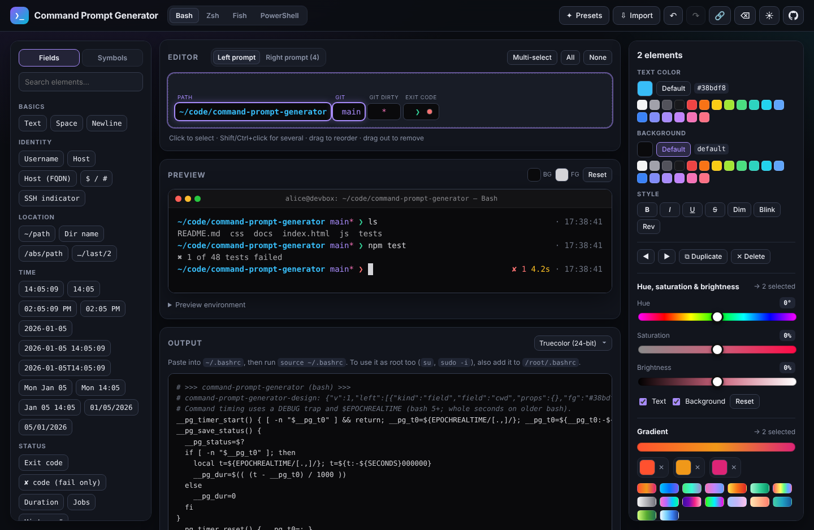
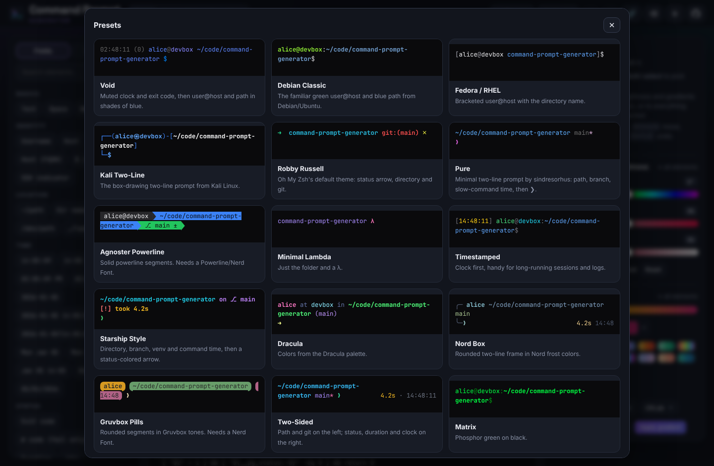
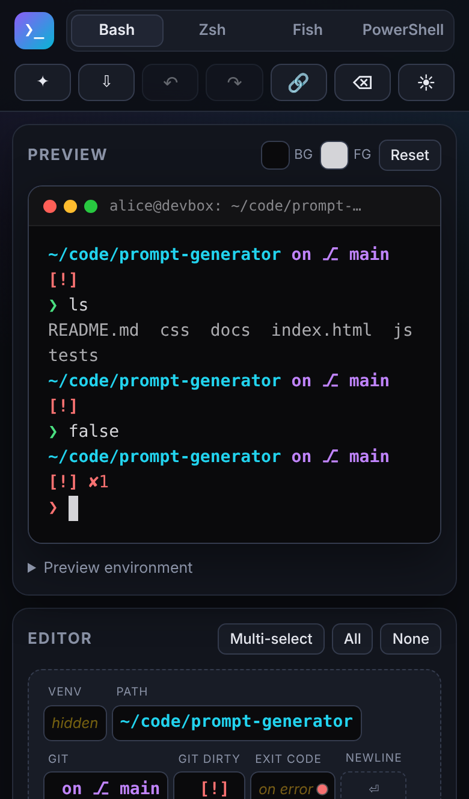

# Command Prompt Generator

A visual builder for shell prompts that runs in the browser. Drag fields and symbols into an editor, style each one, watch it in a live terminal preview, then copy the code for **bash**, **zsh**, **fish** or **PowerShell**.

It has no dependencies, no build step and no server. Open `index.html` in any modern desktop or mobile browser.



<p> </p>

## Features

- **Drag-and-drop editor.** Drag elements in, drag to reorder, and drag out to remove. Works with mouse and touch: on touch screens, tap to add or press and hold to drag.
- **Per-element styling.** Text and background colors (or the terminal default), plus bold, italic, underline, strikethrough, dim, blink and reverse.
- **Live preview.** A dummy terminal shows a successful command and a failing one, so exit-code colors are visible. The terminal colors are adjustable and default to near-black. The preview environment (user, host, directory, git state, venv, SSH, root) can be edited.
- **Right-side prompt.** A second editor builds a right-aligned prompt on the input line. zsh (`RPROMPT`) and fish (`fish_right_prompt`) support this natively; bash and PowerShell emulate it with cursor save/move/restore sequences.
- **Command duration.** A "took 4.2s" field that shows only when the last command ran longer than a threshold you set. Format is auto (`350ms`, `4.2s`, `1m 5s`, `1h 2m`) or whole seconds. Timing uses a DEBUG trap and `$EPOCHREALTIME` in bash, `preexec`/`precmd` in zsh, `$CMD_DURATION` in fish, and history timestamps in PowerShell.
- **Exit code.** Shown with the element colors on success and with its own failure colors (red by default) on a non-zero exit. Uses a template like `✘ {code}` and can be hidden on success. Each shell gets a small helper that captures `$?` before anything else runs.
- **Hue, saturation & brightness.** Select several elements and drag the sliders to adjust them together. The hue slider rotates all hues (blue moves toward teal while yellow moves toward orange). Saturation runs from fully gray (−100%) to fully vivid (+100%), and brightness from black (−100%) to white (+100%). All three are relative to where you started, combine in any order, and Reset (or dragging back to 0) restores the original colors.
- **Gradients.** Paint text or backgrounds with a gradient of 2 to 8 stops from one end of the prompt to the other, or start from one of 16 presets (Sunset, Ocean, Vaporwave, Galaxy, Neon, Cotton Candy, Arctic, …). Interpolation is OKLab, HSL or RGB, and positions can follow character width or element count.
- **Fields.**
  - Identity: user, host (short/FQDN), `$`/`#`, SSH indicator.
  - Location: directory as `~` path, name only, absolute, or last N.
  - Time: 15 preset formats or any `strftime` format.
  - Status: exit code, command duration, jobs, history number.
  - Development: git branch, git dirty marker, Python venv/conda, Node version, kube context, AWS profile.
  - System: shell name and version, TTY, any environment variable, any command's output.
- **Symbols.** Prompt arrows, punctuation, box drawing, Powerline/Nerd Font glyphs (drawn in the preview even without the font) and emoji, plus free text.
- **Import.** Paste, choose a file, or drag one in (`.txt` or `.env`, up to 1 MB). Give it an existing bash `PS1` or zsh `PROMPT`/`RPROMPT` and it becomes editable. Paste a snippet this app generated (any shell) and it comes back exactly as designed: every snippet carries a one-line `# command-prompt-generator-design:` comment. Older bash/zsh snippets without that line are rebuilt from their helper functions. Understands `\[\e[…m\]`, `\033`, `tput`, `\D{…}`, `$(__git_ps1)`, zsh `%F{…}`/`%B`/`%(?..)`, and oh-my-zsh `$fg[…]`.
- **Export.** Copy to the clipboard or download as a `.env` file (`prompt-<shell>.env`). Output can be truecolor, 256-color or 16-color ANSI.
- **17 presets.** Debian, Fedora, Kali, Robby Russell, Pure, Agnoster, Starship-style, Dracula, Nord, Gruvbox, a two-sided prompt, and more.
- **Extras.** Undo/redo, keyboard shortcuts, share links (the prompt is encoded in the URL), dark theme by default with a light theme, and autosave in the browser.

## Using the generated prompt

| Shell | Where it goes |
| --- | --- |
| Bash | Paste into `~/.bashrc`, then `source ~/.bashrc`. For root too, also add it to `/root/.bashrc` |
| Zsh | Paste at the end of `~/.zshrc` (after oh-my-zsh or other theme setup). For root too, also add it to root's `~/.zshrc` |
| Fish | Save as `~/.config/fish/functions/fish_prompt.fish` |
| PowerShell | Add to `$PROFILE` (use an ANSI-capable host such as Windows Terminal) |

**Using it as root:** the bash and zsh prompts rely on helper functions and hooks that are defined in your shell startup file. Child shells don't inherit those, so a root shell from `su` or `sudo -i` needs the snippet in root's own startup file too. Without that, root simply keeps its default prompt. (The bash snippet un-exports `PS1`, so an old `export PS1=...` can't leak a prompt into shells that can't run it.)

The snippet is wrapped in `# >>> command-prompt-generator >>>` markers so it is easy to find and replace later (snippets made before the rename use `# >>> prompt-generator >>>`; Import understands both). It only defines the helpers the prompt uses.

## Development

```
js/color.js     color math: HSL/OKLab, hue shift, gradients, 256/16-color quantization
js/fields.js    element model, field catalogue, palette, strftime, preview samples
js/generate.js  bash / zsh / fish / PowerShell code generators
js/importer.js  PS1 / PROMPT parser
js/tools.js     hue-shift and gradient tools
js/presets.js   built-in presets
js/app.js       the UI
```

The scripts are plain, non-module scripts, so the app also works from `file://`.

Tests use Node (no packages needed):

```
node tests/run.js
```

Besides unit tests for the color math and the importer, the suite generates every preset plus a stress prompt (quotes, `$`, backticks, `%`, `\`, git, venv, env vars, commands, exit codes, all style attributes). It then runs them in the real shells and checks that every installed shell renders byte-identical left and right prompts, for both a fast successful command and a slow failing one. Shells that are not installed are skipped. CI installs bash, zsh, fish and PowerShell.

See [docs/DESIGN.md](docs/DESIGN.md) for the design and how each requirement is met.

## License

[MIT](LICENSE)
